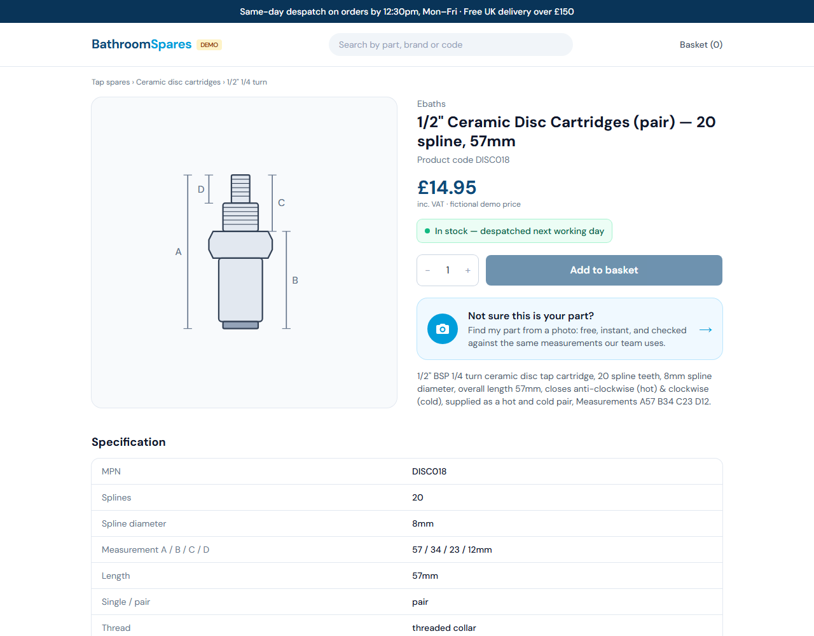
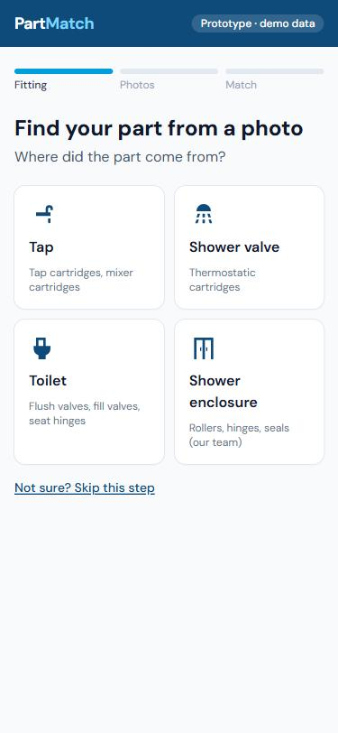
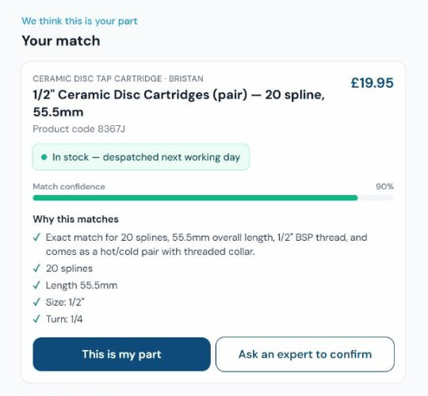
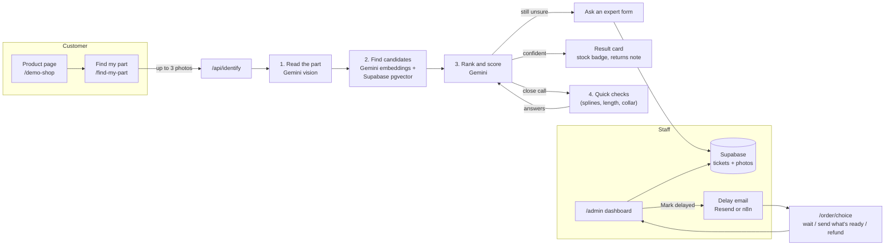

# PartMatch

Prototype: identify a bathroom spare part from a photo, show honest despatch info, and hand unsure cases to an expert. The full spec is in [PARTMATCH_BUILD_PLAN.md](PARTMATCH_BUILD_PLAN.md).

**Live demo:** https://partmatch-alpha.vercel.app (all products, prices, stock, customers and orders are demo data)

| Product page with "Find my part" | Phone: pick the fitting type | Result with reasons and stock |
|---|---|---|
|  |  |  |

## How it works

- **Photo matching** (`lib/identify.ts`): the vision model reads markings and measurements, the catalogue search shortlists likely parts, and a second pass ranks them with a confidence score. Below the threshold (`CONFIDENCE_THRESHOLD`, default 0.75) it asks up to two rounds of quick questions, the same ones a parts specialist would ask, and hands off to the team if it is still unsure.
- **Expert handoff**: the customer's photos, answers and the AI's shortlist arrive in the staff dashboard pre-filled, so staff confirm rather than start from scratch.
- **Delay emails**: staff mark an order delayed; the customer gets an email with three one-click choices, and their answer shows on the dashboard.
- **AI provider switch** (`lib/ai.ts`): Gemini by default (free tier), with backup Gemini models if the main one is overloaded. Claude or OpenAI can be swapped in with `AI_PROVIDER`.

**Stack:** Next.js 14 + Tailwind on Vercel, Supabase (Postgres, pgvector, storage), Gemini, Resend. All free tiers.

## Status

- [x] Phase 0: Next.js 14 + Tailwind + DM Sans scaffold, schema, `lib/ai.ts` provider switch, deployed to Vercel and connected to Supabase.
- [x] Phase 1 (data): 54 products (23 real, 31 sample) and 12 orders in `data/`, loaded with `npx tsx scripts/seed.ts` and embedded with Gemini.
- [x] Phase 2: `/api/identify` + `/api/identify/answer` (`lib/identify.ts`, `lib/match.ts`, `lib/prompts.ts`). Run `npm run eval` to score the test photos.
- [x] Phase 3: `/find-my-part` (fitting type → photos → questions → result, or expert handoff via `/api/tickets`) and `/demo-shop`.
- [x] Phase 4: `POST /api/orders/[id]/delay` (staff) emails Wait / Part-ship / Refund links; `/order/choice` records the answer. Sends via n8n if `N8N_DELAY_WEBHOOK_URL` is set, otherwise Resend if `RESEND_API_KEY` is set, otherwise saves a preview only.
- [x] Phase 5: `/admin` (password from `ADMIN_PASSWORD`): stats, expert enquiry queue with photos, AI reading and shortlist plus a confirm-part action, orders with Mark delayed and View email, identification log.
- [ ] Phase 6: done: rate limiting (10 photo searches a minute per visitor), photo checks (up to 3 photos, 8MB each, real image files only), all keys server-side, friendly errors, README. Still to do: demo video and write-up.

## Setup

1. Create a Supabase project. In the SQL editor, run `supabase/schema.sql`.
2. Copy `.env.example` to `.env` and fill in the Supabase keys and `GEMINI_API_KEY` (free key from aistudio.google.com; it handles both photo reading and search). To use Claude instead, set `AI_PROVIDER=anthropic` and `ANTHROPIC_API_KEY`. Set `DEMO_ORDER_EMAIL` to your own inbox.
3. `npx tsx scripts/build-seed-sql.ts`, then run `supabase/seed.sql` in the SQL editor.
4. `npx tsx scripts/embed-products.ts`. It embeds every product and prints the Phase 1 check query results.
5. `npm run dev`

## Before a demo

`npm run reset-demo` clears photo searches, expert enquiries, sent-email logs and uploaded photos, and puts the 12 demo orders back to their starting state. It does not change the product catalogue, stock or search embeddings.

## Data notes

- Edit `data/catalogue.ts`, not `supabase/seed.sql`, because the seed file is generated from it. After changing a product, update the live database too: re-run `scripts/build-seed-sql.ts`, update the product row in Supabase, and re-embed it.
- Entries with a `source` URL are real products, with dimensions taken from public listings in Nov 2026. Listings often disagree by a few mm, so treat them as best published figures, not measurements.
- Every `PM-` code is a fictional own-brand near-twin, there to test the clarifying questions. Seat hinges are all samples, because no reliable fixing-centre specs were found.
- Test photos go in `test-images/` (see `expected.json`). They're git-ignored: they come from public listings and are for private testing only.
- All prices, stock levels, customers and orders are fictional.
- The brand colours in `app/globals.css` are placeholders. Sample the real ones by eye.
